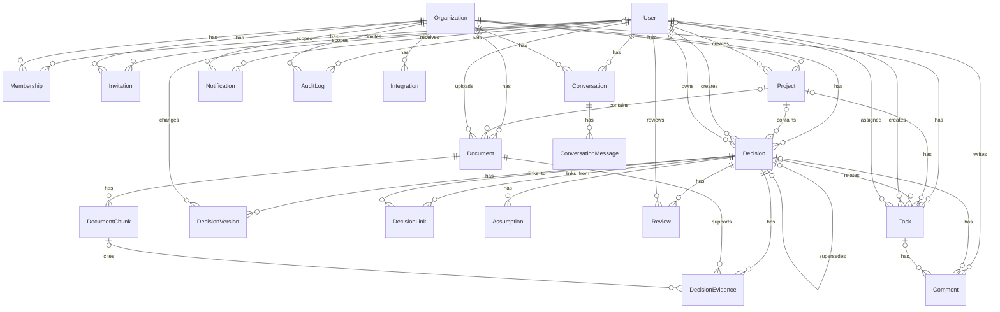

# DeciVault Database Design

## Overview

This document describes the complete Prisma/PostgreSQL schema for DeciVault. The design supports multi-tenant organizations, decision tracking with full history, document management with chunking, collaboration (tasks/comments), notifications, audit logs, and prepared paths for AI search and integrations.

## Enums

| Enum | Values | Purpose |
|---|---|---|
| UserStatus | ACTIVE, INACTIVE, SUSPENDED | Account status |
| Role | OWNER, ADMIN, MEMBER, VIEWER | Membership role in organization |
| InvitationStatus | PENDING, ACCEPTED, EXPIRED, REVOKED | Invitation lifecycle |
| ProjectStatus | ACTIVE, ARCHIVED, ON_HOLD | Project state |
| DocumentProcessingStatus | PENDING, PROCESSING, COMPLETED, FAILED | Document ingestion/processing |
| DecisionStatus | PROPOSED, APPROVED, REJECTED, SUPERSEDED, ARCHIVED | Decision lifecycle |
| AssumptionStatus | ACTIVE, CONFIRMED, INVALIDATED, ARCHIVED | Assumption validation state |
| TaskStatus | OPEN, IN_PROGRESS, COMPLETED, CANCELLED | Task state |
| TaskPriority | LOW, MEDIUM, HIGH, URGENT | Task priority |
| IntegrationStatus | CONNECTED, DISCONNECTED, ERROR | Integration connection state |
| IntegrationProvider | SLACK, GITHUB, GOOGLE_DRIVE, MICROSOFT_TEAMS, OTHER | Integration providers |
| MessageRole | USER, ASSISTANT, SYSTEM | Conversation message role |
| NotificationType | DECISION_UPDATE, TASK_ASSIGNED, REVIEW_DUE, COMMENT, MENTION, INVITATION, SYSTEM | Notification categories |

## Models

### Users & Authentication
- **User**: Core identity. Stores email (unique), `passwordHash` (never plaintext), names, status, timestamps. Has relations to memberships, created/owned content, comments, notifications, audit logs, conversations, reviews.
- **Organization**: Tenant boundary. Unique `slug`. Owns all org-scoped resources.
- **Membership**: Join table between User and Organization with role. Unique composite (userId, organizationId). Enforces membership uniqueness.
- **Invitation**: Org invitation by email with unique `token`, role, status, `expiresAt`, inviter. Supports secure invite flow.

### Projects
- **Project**: Belongs to Organization, created by User. Optional grouping for Documents/Decisions/Tasks. Status tracked.

### Document Management
- **Document**: Belongs to Organization, optionally Project, uploaded by User. Stores filename, mimeType, fileSize, unique `storageKey` (files in object storage, not DB), `processingStatus`, `processingError`. Relations to chunks and decision evidence.
- **DocumentChunk**: Extracted text chunks from Document with `chunkIndex`, JSONB `metadata`. Unique (documentId, chunkIndex). Ready for vector embeddings; add `vector` column via extension when needed.

### Decision Management
- **Decision**: Core decision record in Organization/Project. Creator and owner tracked. Statuses include lifecycle states; `supersededById` allows tracking supersession (unique 1:1 relation in schema as designed). Stores structured JSONB for alternatives/risks/consequences, approval/rejection metadata and timestamps.
- **DecisionVersion**: Historical snapshots of decisions. Unique (decisionId, version). Stores full `snapshot` as JSONB, who changed it, summary. Enables audit/history.
- **DecisionEvidence**: Links Decision to Document and optionally specific DocumentChunk with note. Unique composite to prevent duplicates.
- **DecisionLink**: Directed relations between decisions with `relationType` and note. Unique (fromId, toId, relationType) prevents duplicate links.

### Assumptions & Reviews
- **Assumption**: Belongs to Decision. Tracks validation state and evidence.
- **Review**: Scheduled review of a Decision by Reviewer (User). Tracks scheduled/completed dates, outcome, notes.

### Tasks & Collaboration
- **Task**: Org-scoped, optionally linked to Project and/or Decision. Has creator and assignee (different User relations). Priority/status/due date.
- **Comment**: Threaded comments that can attach to Decision or Task (or both fields nullable; at least one expected in practice). Tracks edits via `editedAt`.

### Notifications & Audit Logs
- **Notification**: Recipient-scoped with Organization. Tracks read status and timestamps. Indexed for unread queries.
- **AuditLog**: Append-only audit trail. Stores actor (nullable if system), organization, action, entityType/entityId, JSONB metadata, timestamp. No cascade deletes from actors/orgs that would erase history.

### Integrations & AI Conversation History
- **Integration**: Org-level integration config. Stores provider/status/external account; `encryptedConfig` for non-plaintext secrets. No raw tokens stored.
- **Conversation**: User conversation in Organization context with metadata.
- **ConversationMessage**: Messages with role/content/metadata; no API secrets stored.

## Relationships & Constraints

- **Multi-tenancy**: Most resources belong to Organization; foreign keys enforce org context. Cross-org relations prevented by explicit org scoping in schema design.
- **Users in multiple orgs**: Via Membership (unique per user-org).
- **Roles**: Enum on Membership.
- **Cascades**: `DocumentChunk` cascades on Document delete. `DecisionVersion`, `DecisionEvidence`, `Assumption`, `Review`, `Comment` (on Decision/Task), `ConversationMessage`, `Notification` (recipient), `Conversation` (user) use cascades where child data has no independent long-term value without parent. **Restricted/SetNull** used for Users/Orgs/Projects/Documents/Decisions to preserve audit history (AuditLog.actor nullable with SetNull; Decision links use SetNull on supersession; Tasks/Documents detach via SetNull where appropriate).
- **Uniqueness**: emails, slugs, tokens, membership pairs, document storage keys, chunk positions per document, decision version numbers, decision evidence combinations, decision links, supersession.
- **Indexes**: Added for common filters (org, project, status, owner/assignee, dates, read state, audit lookups).

## pgvector & AI Search

- PostgreSQL `vector` extension is created in migration if available (gracefully omitted from schema config; migration attempts creation).
- `DocumentChunk` is designed for embeddings - add `embedding vector(n)` column when enabling semantic search. Do **not** store large embedding arrays as JSONB. Use pgvector with raw SQL/indexes as needed.
- AI provider keys/config kept out of DB schema.

## Feature Mapping

| Feature | Tables |
|---------|--------|
| Auth/Orgs | User, Organization, Membership, Invitation |
| Projects | Project |
| Documents/RAG prep | Document, DocumentChunk (with future vector) |
| Decisions/History | Decision, DecisionVersion, DecisionEvidence, DecisionLink, Assumption, Review |
| Tasks/Collab | Task, Comment |
| Notifications | Notification |
| Audit | AuditLog |
| Integrations | Integration |
| AI Conversations | Conversation, ConversationMessage |

## ER Diagram

